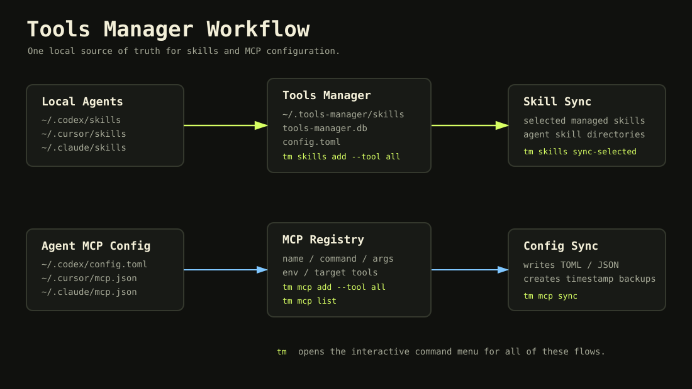
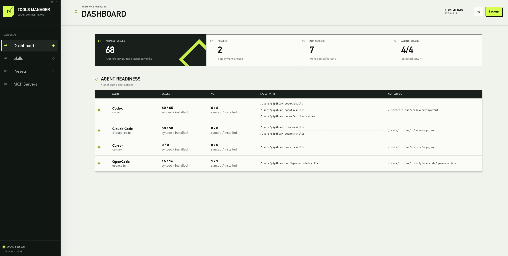
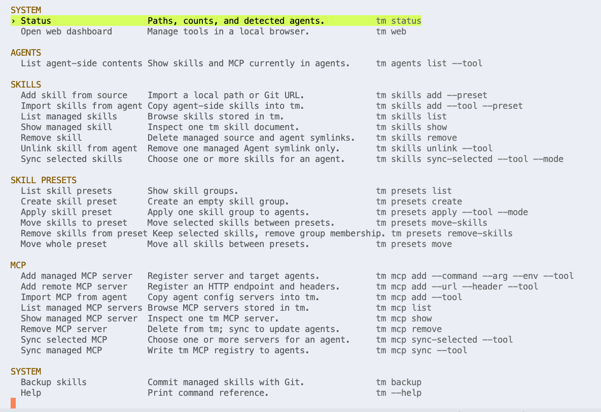

# Tools Manager

[English](README.md)

Tools Manager (`tm`) 是一个基于 Bun 的本地管理工具，用来统一管理 Codex、Claude Code、Cursor 和 OpenCode 等 AI Agent 的 skills 与 MCP server 配置。

它提供一个本地统一管理入口：

* Skills 存放在 `~/.tools-manager/skills`
* MCP servers 存储在 Tools Manager 数据库中，并可同步到各 Agent 的配置文件

**推荐使用 Web 管理台完成日常操作。** 安装后运行 `tm web` 即可打开。

下面这张图展示 skills 和 MCP servers 如何在本地 Agent 与 Tools Manager 存储之间流转：



## 环境要求

* Bun `>= 1.3.0`
* Git，用于从 Git URL 导入 skills，以及执行 `tm backup`

## 安装

全局安装：

```bash
npm install -g tools-manager
```

验证 CLI：

```bash
tm status
```

将全局安装的 CLI 更新到最新发布版本：

```bash
tm update
```

该命令执行 `npm install --global tools-manager@latest`，沿用 npm 的 registry 和全局安装路径配置。需要 npm 可用，且对全局安装目录有写入权限。不会修改已管理的 skills、MCP 记录和配置。更新的是全局安装的包，而非源码检出目录。

如果是源码检出方式使用，见 [开发](#开发)。

## 快速开始

初始化 Tools Manager，然后打开 Web 管理台：

```bash
# 创建 Tools Manager 的本地管理目录和默认配置。
tm init

# 启动管理台并自动在浏览器中打开。
tm web
```

进入管理台后，可以从 Agent 导入已有 skills、管理 MCP servers，并将内容同步回目标 Agent。

如果还没有 link 或安装这个包，可以使用：

```bash
bun run tm init
bun run tm web
```

默认情况下，Tools Manager 会把状态写入：

```text
~/.tools-manager
```

设置 `TOOLS_MANAGER_HOME` 可以使用自定义管理目录。

## Web 管理台

启动本地管理页面并自动在浏览器中打开：

```bash
tm web
```



管理台复用 CLI 的核心能力，可以管理 skills、MCP servers、本地 Codex 和 Claude Code 会话，执行 Agent 导入与同步，以及 Git 备份。

* Skills 和 MCP 视图输入关键词后通过 Search 按钮或 Enter 执行搜索，`All` 视图还支持单项同步、多选和全选同步。
* Agent 筛选会展示该 Agent 的完整已安装资源：受管资源保留操作，点击未受管资源名称可查看只读详情，但不能编辑、同步或删除。
* Agent Readiness 使用 `已同步数 / 已安装总数` 展示数量。
* 点击 skill 名称可以查看 source 元数据并编辑完整 `SKILL.md`。
* 点击 MCP server 名称可以修改名称、传输方式、command 或 URL、arguments、environment、HTTP headers、目标 tools 和启用状态。
* MCP environment 与 header 值只通过本地详情接口读取，管理台 snapshot 不会暴露这些值。
* Hooks 页面按 Agent 和生命周期事件展示已安装/已启用的 handler；可编辑 Codex 用户 hooks、Claude Code hooks 与 Cursor hooks，也可启停已由 Codex 审查信任的插件 hook，插件定义和 OpenCode 插件事件保持只读。
* Sessions 支持扫描 Codex 和 Claude Code 历史会话，并提供 Provider 筛选、搜索、按需查看正文、恢复命令和带校验的删除操作。
* Ports 展示当前用户可见的 TCP 监听端口、UDP 绑定端口及进程信息，支持按端口、PID 或进程搜索。Stop 操作会先确认程序路径、进程和受影响的端口，再发送 SIGTERM 请求正常退出；管理台自身和其他用户的进程不可停止。提示语跟随浏览器语言，按钮保持英文。此功能支持 macOS/Linux，依赖 `lsof`。
* Sessions 右上角的 **Clean up** 按钮会预览清理数量和预计释放空间，确认后删除超过 90 天未活跃、或超过 30 天未活跃且仅有 0–1 条用户消息的会话。清理范围跟随 Provider 筛选（不受搜索词影响）；最近修改过的文件会保留，完成后显示实际释放空间，包含 Claude 会话附属文件。删除不可恢复。

源码仓库中也可运行 `npm run prune` 预览，使用 `npm run prune -- --yes` 执行相同规则的清理。

服务只监听 `127.0.0.1`。默认使用 `4343` 端口，端口被占用时会自动尝试后续本地端口。也可以指定端口或禁止自动打开浏览器：

```bash
tm web --port 4400
tm web --no-open
```

使用管理台期间需保持终端进程运行，按 `Ctrl+C` 停止服务。

在源码仓库中调试时，启动监听模式的 Web 服务：

```bash
bun run web
```

首次打开 `http://127.0.0.1:4343` 即可。导入的源码文件发生变化后，Bun 会重启服务，已打开的管理页面会在新服务就绪后自动刷新。需要隔离测试数据时可以指定临时管理目录：

```bash
TOOLS_MANAGER_HOME=/tmp/tools-manager-dev bun run web
```

## 命令行工具

需要脚本化操作或偏好终端工作流时，可以直接使用 CLI。下面的命令会导入所有本地 Agent 中已有的 skills：

```bash
tm init
tm skills add --tool all
tm skills list
```

不想记子命令时，运行无参数的 `tm` 打开交互式命令菜单：

```bash
tm
```



菜单支持用方向键选择常用的 skill、MCP、agent 和 backup 命令。菜单包含手动添加 skill source、手动添加 MCP server、从已有 Agent 导入的流程。涉及 tool 参数时会进入选项选择器，默认选择 `all`。命令执行后，按 `Enter` 或 `Esc` 返回菜单。

## Skills

### 导入 Skills

添加本地 skill 目录：

```bash
tm skills add ./my-skill
```

从某一个本地 Agent 导入已有 skills：

```bash
tm skills add --tool codex
tm skills add --tool cursor
tm skills add --tool claude_code
tm skills add --tool opencode
```

从所有支持的本地 Agent 导入已有 skills：

```bash
tm skills add --tool all
```

从 Agent 导入时，Tools Manager 会把 skills 复制到 `~/.tools-manager/skills`，然后用指向托管副本的 symlink 替换原本的本地 Agent skill 目录。

Codex 和 Claude Code 都兼容共享的 `~/.agents/skills`，同时保留各自的 `~/.codex/skills` 和 `~/.claude/skills`。导入、列出、同步和解除链接都会处理这些目录；同名 skill 在列表和导入结果中只显示一次。

从 Git 导入 skill：

```bash
tm skills add 'git@gitlab.company.com:group/repo.git#main:path/to/skill'
```

如果 source 中包含多个 skill 目录，会导入所有发现的 skills。已有同名 skill 会被更新。

仓库目录结构要求见 [Remote Skill Repositories](docs/remote-skill-repositories.md)。

### 查看 Skills

列出托管的 skills：

```bash
tm skills list
```

列出当前本地 Agent 可见的 skills：

```bash
tm skills list --tool codex
tm skills list --tool all
```

查看某个托管 skill：

```bash
tm skills show my-skill
```

### 移除 Skills

移除某个托管 skill：

```bash
tm skills remove my-skill
```

如果 Agent 的 skill 目录中存在指向托管 skill source 的 symlink，Tools Manager 会展示这些 symlink，并在删除托管 source 和 Agent symlink 前要求确认。非交互场景可使用 `--yes`：

```bash
tm skills remove my-skill --yes
```

只删除某个 Agent 的受管 symlink，同时保留 tm source 和其他 Agent 链接：

```bash
tm skills unlink my-skill --tool codex
```

### 同步 Skills

把一个或多个选定 skills 同步到 Agent skill 目录：

```bash
tm skills sync-selected my-skill --tool cursor
tm skills sync-selected skill-a skill-b --tool all --mode copy
```

命令默认使用 `--tool all`，并遵循配置中的 `sync_mode`。传入 `--mode symlink` 或 `--mode copy` 可以覆盖本次执行。

无参数 `tm` 交互菜单为选定 skill 同步提供 checkbox 式多选流程。

## MCP Servers

### 添加和导入 MCP Servers

添加 MCP server 到 Tools Manager：

```bash
tm mcp add playwright --command npx --arg @playwright/mcp@latest --tool codex
tm mcp add remote-api --url https://example.com/mcp --header "Authorization=Bearer $MCP_TOKEN" --tool all
```

MCP server 支持本地 `stdio` 传输（`--command`、`--arg`、`--env`）和远程 Streamable HTTP（`--url`、`--header`）。`--command` 与 `--url` 必须二选一；多个 HTTP header 可重复传入 `--header`。

从 Agent 配置文件导入已有 MCP servers：

```bash
tm mcp add --tool codex
tm mcp add --tool all
```

### 查看和移除 MCP Servers

列出托管的 MCP servers：

```bash
tm mcp list
```

列出当前本地 Agent 配置中的 MCP servers：

```bash
tm mcp list --tool codex
tm mcp list --tool all
```

查看某个托管 MCP server：

```bash
tm mcp show playwright
```

移除某个托管 MCP server：

```bash
tm mcp remove playwright
```

### 同步 MCP Servers

把托管 MCP servers 同步回 Agent 配置文件：

```bash
tm mcp sync
tm mcp sync --tool codex
```

只同步选定的 MCP servers：

```bash
tm mcp sync-selected playwright --tool codex
tm mcp sync-selected server-a server-b --tool all
```

无参数 `tm` 交互菜单支持该命令的多选和全选。

默认行为：

* `tm mcp sync` 使用 `--tool all`
* 同步写入配置文件前会创建带时间戳的备份

支持的配置目标：

| Agent         | MCP 配置                             |
| ------------- | ---------------------------------- |
| `codex`       | `~/.codex/config.toml`             |
| `claude_code` | `~/.claude/mcp.json`               |
| `cursor`      | `~/.cursor/mcp.json`               |
| `opencode`    | `~/.config/opencode/opencode.json` |

## Backup

用 Git 备份托管 skills：

```bash
tm backup
```

如果需要，`tm backup` 会在 `~/.tools-manager/skills` 中初始化 Git 仓库，提交 skill 变更；当 `~/.tools-manager/config.toml` 中配置了 `git_remote` 时，还会执行 push。

## 命令参考

```bash
tm init
tm web [--port <port>] [--no-open] [--dev]
tm status [--json]
tm update [--json]
tm agents list [--tool <tool|all>] [--json]
tm skills add <source>
tm skills add --tool <tool|all>
tm skills list [--json]
tm skills list --tool <tool|all> [--json]
tm skills show <name> [--json]
tm skills remove <name> [--yes]
tm skills unlink <name> --tool <codex|claude_code|cursor|opencode>
tm skills sync-selected <name...> [--tool <tool|all>] [--mode <symlink|copy>]
tm mcp add <name> (--command <cmd> [--arg value] [--env K=V] | --url <url> [--header K=V]) [--tool <tool|all>]
tm mcp add --tool <tool|all>
tm mcp list [--json]
tm mcp list --tool <tool|all> [--json]
tm mcp show <name> [--json]
tm mcp remove <name>
tm mcp sync-selected <name...> [--tool <tool|all>]
tm mcp sync [--tool <tool|all>]
tm backup
```

支持的 tools：

```text
codex
claude_code
cursor
opencode
all
```

## 开发

### 安装和检查

安装依赖并运行检查：

```bash
bun install
bun run check
```

本仓库通过 `.npmrc` 和 `bunfig.toml` 将 npm 与 Bun 安装固定到 npmmirror registry。

### 从源码运行

通过 package script 运行 CLI：

```bash
bun run tm status
bun run tm skills list
```

### 构建和验证软件包

构建发布用的 CLI bundle：

```bash
bun run build
ls -la dist
```

需要保留 `package.json` 中的 `bin` 映射。它负责在 npm 全局安装后把 `dist/cli.js` 暴露为 `tm` 命令；删除后只能通过 package script 或直接执行文件来使用。

按用户实际使用方式测试 `tm` 二进制：

```bash
npm link
tm status
tm skills list
npm unlink -g tools-manager
```

## 发布

### 检查软件包

发布前：

```bash
bun run release:dry
```

检查 dry-run 输出。它应该只包含：

* `package.json`
* `README.md`
* `README.zh-CN.md`
* `SKILL.md`
* `dist/**`
* `docs/**`

### 发布版本

发布：

```bash
bun run release
```

发布并自动升级版本：

```bash
bun run release:patch
bun run release:minor
bun run release:major
```

发布后，在干净 shell 中测试安装：

```bash
npm install -g tools-manager
tm --help
tm status
```

## 备注

* `tm skills add` 支持本地文件夹、GitHub URL、内部 GitLab URL、SSH Git URL，以及 `#ref:path/to/skill`。
* Git 认证交给本地 Git 配置处理：SSH keys、VPN、credential helpers 和 tokens。启用 2FA 的私有 HTTPS 仓库需要 personal access token，或改用 SSH Git URL。
* `tm skills add --codex` 和 `tm skills add --all` 会作为兼容别名保留。
* `tm skills remove` 会删除托管 skill 文件，并在确认后移除指向托管 source 的 Agent symlinks。
* `tm mcp remove` 只会从 Tools Manager 删除 server；运行 `tm mcp sync` 后才会更新 Agent 配置文件。
* `--json` 可用于 list/status 类命令，方便脚本调用。
